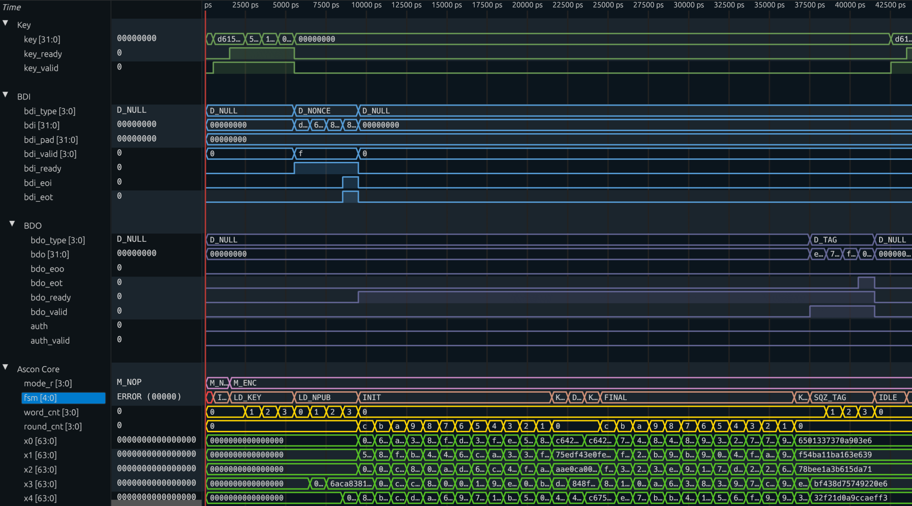

# Hardware Design of Ascon (SP 800-232)

This is a SystemVerilog implementation of Ascon as specified by NIST in [SP 800-232](https://csrc.nist.gov/pubs/sp/800/232/final).

Ascon is a family of authenticated encryption and hashing algorithms designed to be lightweight and easy to implement, even with added countermeasures against side-channel attacks. Ascon has been selected as new standard for lightweight cryptography in the [NIST Lightweight Cryptography competition](https://csrc.nist.gov/Projects/Lightweight-Cryptography) (2019–2023).

The following Ascon modes are available:
- `Ascon-AEAD128`
- `Ascon-Hash256`
- `Ascon-XOF128`
- `Ascon-CXOF128`

## Available Variants

The Ascon core can be configured to support the following combinations of data-bus width and unrolled rounds of Ascon-p:

| **Variant** | **Bus Width** | **Unrolling** |
|-------------|:-------------:|:-------------:|
| **v1**      |     32-bit    |       1       |
| **v2**      |     32-bit    |       2       |
| **v3**      |     32-bit    |       4       |
| **v4**      |     64-bit    |       1       |
| **v5**      |     64-bit    |       2       |
| **v6**      |     64-bit    |       4       |

## Performance

Cycles required for processing **x** bytes of message and **y** bytes of associated data:

| **Variant** | **Mode**        | **( x=0, y=0 )** | **( x=32, y=32 )** | **( x=1024, y=1024 )** |
|-------------|-----------------|:----------------:|:------------------:|:----------------------:|
| **v1**      | `Ascon-AEAD128` |         41       |          99        |           1587         |
| **v2**      | `Ascon-AEAD128` |         29       |          67        |           1059         |
| **v3**      | `Ascon-AEAD128` |         23       |          51        |            795         |
| **v4**      | `Ascon-AEAD128` |         35       |          85        |           1325         |
| **v5**      | `Ascon-AEAD128` |         23       |          53        |            797         |
| **v6**      | `Ascon-AEAD128` |         17       |          37        |            533         |

Cycles required for processing **x** bytes of message:

| **Variant** | **Mode**        | **( x=0 )** | **( x=32 )** | **( x=1024 )** |
|-------------|-----------------|:-----------:|:------------:|:--------------:|
| **v1**      | `Ascon-Hash256` |      70     |      126     |      1862      |
| **v2**      | `Ascon-Hash256` |      40     |       72     |      1064      |
| **v3**      | `Ascon-Hash256` |      25     |       45     |       665      |
| **v4**      | `Ascon-Hash256` |      66     |      118     |      1730      |
| **v5**      | `Ascon-Hash256` |      36     |       64     |       932      |
| **v6**      | `Ascon-Hash256` |      21     |       37     |       533      |

## Files

- `rtl/`: SystemVerilog implementation of Ascon.
- `surfer/`: Files for the [Surfer](https://surfer-project.org/) waveform viewer.
- `syn/`: Files for [Yosys](https://github.com/YosysHQ/yosys) synthesis.
- `.gitignore`: List of files/folders to be ignored for git versioning.
- `ascon.py`: Ascon's python reference implementation [pyascon](https://github.com/meichlseder/pyascon).
- `CITATION.cff`: Github citation information file.
- `file_list.txt`: List of verilog source files.
- `LICENSE`: License file.
- `Makefile`: Makefile for rtl simulation, rtl synthesis, and waveform viewing.
- `README.md`: This README.
- `requirements.txt`: Relevant python libraries for cocotb test bench.
- `test_all.sh`: Bash script that runs cocotb test bench for all Ascon core variants.
- `test.py`: Python script for running the [cocotb](https://www.cocotb.org/) test bench.

## Interface

The following table contains a description of the interface signals:

| **Name**     | **Bits** | **Description**                                  |
|--------------|:--------:|--------------------------------------------------|
| `clk`        |     1    | Clock signal.                                    |
| `rst`        |     1    | Reset signal. Note: Asynchronous active high.    |
| `key`        |   32/64  | Key data input.                                  |
| `key_valid`  |     1    | Key data is valid.                               |
| `key_ready`  |     1    | Ascon core is ready to receive a new key.        |
| `bdi`        |   32/64  | Block data input (BDI).                          |
| `bdi_valid`  |    4/8   | Valid BDI data bytes.                            |
| `bdi_ready`  |     1    | Ascon core is ready to receive data.             |
| `bdi_eot`    |     1    | Last BDI block of this type.                     |
| `bdi_eoi`    |     1    | Last BDI data block (excluding tag).             |
| `bdi_type`   |     4    | Type of BDI data.                                |
| `mode`       |     4    | Ascon mode.                                      |
| `bdo`        |   32/64  | Block data output (BDO).                         |
| `bdo_valid`  |     1    | BDO data is valid.                               |
| `bdo_ready`  |     1    | Test bench is ready to receive data.             |
| `bdo_type`   |     4    | Type of BDO data.                                |
| `bdo_eoo`    |     1    | Last BDO block (only for XOF modes).             |
| `bdo_eot`    |     1    | Last BDO block of this type.                     |
| `auth`       |     1    | Authentication success.                          |
| `auth_valid` |     1    | Authentication output is valid.                  |

## Python Environment

This repository is tested with Python 3.14. You can use [uv](https://docs.astral.sh/uv/) to install that version and create a virtual environment (`.venv`) without changing your system Python.

On Linux, install `uv` if it is not already available:

```bash
curl -LsSf https://astral.sh/uv/install.sh | sh
export PATH="$HOME/.local/bin:$PATH"
```

From the repository root, install Python 3.14, create and activate the virtual environment, and install the pinned test dependencies:

```bash
uv python install 3.14
uv venv --python 3.14 .venv
source .venv/bin/activate
uv pip install -r requirements.txt
```

In each new terminal, run `source .venv/bin/activate` before running `make`.

## Simulation Environment

RTL simulation uses Verilator and cocotb. On Ubuntu, install Verilator and the build tools:

```bash
sudo apt update
sudo apt install build-essential verilator
```

Alternatively, use the Verilator bundled with [OSS CAD Suite](https://github.com/YosysHQ/oss-cad-suite-build). If Ubuntu's package is too old, you can also [build Verilator from source](https://verilator.org/guide/latest/install.html#git-quick-install).

Set up and activate the [Python environment](#python-environment) for cocotb, after activating OSS CAD Suite if you use it. Then check that `verilator --version` works.

## Synthesis Environment

Synthesis uses Yosys and its Slang plugin. On Ubuntu, install Yosys:

```bash
sudo apt update
sudo apt install yosys
```

Alternatively, use [OSS CAD Suite](https://github.com/YosysHQ/oss-cad-suite-build), which bundles recent versions of Yosys and Slang together.

Check that Yosys can load the plugin with `yosys -Q -T -p 'plugin -i slang'`. Activate the [Python environment](#python-environment) after activating OSS CAD Suite (if used) and before running `make syn`, because the Makefile loads cocotb's build rules.

## RTL Simulation

Run `make sim` (or `make`) to execute the cocotb test bench. Simulator binaries and test results are written to `builds/sim/<variant>/`, where `<variant>` is lowercase (for example, `v1`).

## RTL Synthesis

Run `make syn` to synthesize the design with the simple cell library. Set `VARIANT` to select a variant (for example, `make syn VARIANT=V6`). The netlist is written to `builds/net/<variant>/syn.v`.

## RTL Post-Synthesis Simulation

- Run `make sim cell=simple VARIANT=V6` (or omit `VARIANT` for V1). This builds the selected netlist if needed and runs the cocotb tests against it. Simulator binaries and results go in `builds/sim/<variant>-syn/`.
- Run `bash test_all.sh 1` to test all variants after synthesis, following the RTL tests. Without `1`, the script runs only the RTL tests.

## View Waveforms

- `make surf` runs the simulation with tracing enabled and opens `dump.fst` from `builds/sim/<variant>-rtl-trace/` or `builds/sim/<variant>-syn-trace/`.
- Install the [Surfer](https://surfer-project.org/) waveform viewer.
  - `cargo install --git https://gitlab.com/surfer-project/surfer surfer`
- View waveform of cocotb test bench run:
  - `make`
  - `make surf`
- View waveform of post-synthesis cocotb test bench run:
  - `make syn`
  - `make sim cell=simple`
  - `make surf cell=simple`
- Example waveform of test bench output:

<p align="center">

</p>

## Integration

- The Ascon core uses an interface that allows easy integration into projects using, e.g., an AXI4 bus.
- The nonce/tag bytes need to be transferred using full BDI blocks.
- `bdi_eoi` needs to be high on the last input data block excluding the tag (i.e., the last `D_MSG` block, or the last `D_AD`/`D_NONCE` block if subsequent data segments are empty).
- If a new key is loaded, `key_valid` needs to be high on the same cycle that `mode` is sampled.
- If an empty hash/XOF input is processed, `bdi_eoi` needs to be high on the same cycle that `mode` is sampled.
- If the length of AEAD output data is not a multiple of 4 (or 8) bytes then the last data block needs to be truncated according to the `bdi_valid` signal. See test bench for an example.
- The length of XOF/CXOF output needs to be greater than zero bytes.
- The CXOF customization string starts with a 64-bit length encoding. The customization string may contain 0 to 256 bytes (excluding length encoding). The entire customization string needs to be sent as a single `D_AD` segment.
- The Ascon core can handle stalls of the input/output data bus. This can be tested by setting `STALL_INPUT` or `STALL_OUTPUT` in `test_helpers.py`.
- Many ciphers, including Ascon, require that decrypted plaintext is not released to a potential attacker until the tag of the ciphertext was successfully verified. The current design of the Ascon core outputs decrypted plaintext immediately which could lead to security degradation. For real applications an additional buffer should be used to temporarily store decrypted plaintext until the Ascon core has successfully verified the ciphertext tag.

## Contact

- Robert Primas (rprimas 'at' proton.me, https://rprimas.github.io)

## Acknowledgements

The interface of the Ascon core is inspired by the [LWC Hardware API Development Package](https://github.com/GMUCERG/LWC) that was mainly developed by the [Cryptographic Engineering Research Group](https://cryptography.gmu.edu) at George Mason University (GMU).
